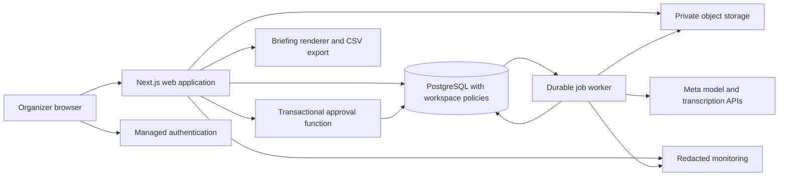

# Application architecture

## Summary

Recommend one TypeScript codebase with a web application and a background worker. Use managed authentication, PostgreSQL, and private object storage. This keeps the solo build small while allowing work to survive browser closure and service restarts.

## Context and options considered

You have an empty repository, a short delivery window, and a workflow that needs transactions, file handling, and dependable review. There is no existing stack to preserve and no evidence of a need for microservices, a vector database, or a framework for autonomous agents.

| Approach | Strengths | Costs and tradeoffs |
|---|---|---|
| Next.js with managed PostgreSQL, auth, and storage (recommended) | One language, integrated page and API work, established database transactions, small operational surface | React and server/client boundaries need care; managed service coupling; background work needs its own process |
| React SPA with Python API and managed PostgreSQL | Clear API boundary and convenient Python processing ecosystem | Two application runtimes, more deployment and validation plumbing, slower solo iteration |
| Django with server rendered pages and PostgreSQL | Mature auth, forms, transactions, straightforward backend | Rich schedule and comparison interactions need extra frontend integration; separately operated media and email services |

Recommendation is based on the domain and delivery constraints, not an assumption about your personal framework experience. If TypeScript is unfamiliar, the effort ranges should increase. A container deployment is selected to support bounded audio conversion and durable worker execution without tying work to a page request.

## Decision and proposed stack

| Layer | Recommended choice | Reason |
|---|---|---|
| Application pattern | Modular monolith, two process types from one repository | Share domain rules without distributed domain services |
| Language | TypeScript in strict mode | Share request, UI, and validation types |
| Runtime and web | Supported Node LTS, Next.js App Router, React | Server rendering and ordinary HTTP handlers in one application |
| UI | Semantic HTML, CSS variables and modules, accessible dialog primitives | Exact visual system without a large component framework |
| Validation | Zod at boundaries, generated JSON Schema for model responses | Explicit shapes and limits, with semantic validation after parsing |
| Persistence | Supabase PostgreSQL, SQL migrations, `supabase-js` | Relational ownership, immutable revisions, transactional functions |
| Authentication | Supabase email OTP using custom SMTP | A single sign in mechanism and no password management |
| Mail delivery | Resend SMTP, only for authentication and account notices | Uses the selected auth service's SMTP interface; no marketing system |
| Object storage | Private Supabase Storage buckets | Reuse tenancy and access controls rather than adding another live store |
| Jobs | PostgreSQL job table, one Node worker polling leased work | Durable retries without Redis or a separate queue product |
| AI transport | Server HTTP adapter calling Meta APIs | Small explicit interface; no extra agent framework |
| Audio conversion | Sandboxed `ffmpeg` process inside the worker container | Converts approved browser recording formats to the documented transcription format |
| Deployment | Render web service and worker, same region as database where available | Ordinary container lifecycle and background processing |
| Errors and metrics | Structured redacted logs plus Sentry error tracking | Correlate failures without storing event contents in telemetry |
| Tests | Vitest, real PostgreSQL integration tests, Playwright and axe checks | Exercise rules, transaction races, and the browser journey |

These are proposed products, not installed packages. At the approved scaffold stage, pin the then supported patched versions and runtime in a lockfile and container image. Do not use an unpinned `latest` deployment. The current Next.js documentation supports container hosting; publish no application version claim before installation. [Next.js hosting](https://nextjs.org/docs/app/guides/self-hosting).

Supabase supports email codes, while public delivery needs a configured SMTP provider rather than assuming the built in sender is adequate. [Email authentication](https://supabase.com/docs/guides/auth/auth-email-passwordless), [custom SMTP](https://supabase.com/docs/guides/auth/auth-smtp). Resend documents the Supabase SMTP path. [Resend setup](https://resend.com/blog/how-to-configure-supabase-to-send-emails-from-your-domain). Sender domain ownership, delivery limits, and account access remain setup dependencies. No email is sent during planning.

## System boundaries

The diagram shows the worker claiming jobs in the database, not the database invoking arbitrary code. The browser never receives model keys, database credentials, or broad storage access. Authentication is checked again by every protected API. All private pages and responses use `no-store`; a shared cache must never contain an organizer's plan.

## Modules and responsibility

| Module | Responsibility | Boundary |
|---|---|---|
| Identity | Sessions, workspace bootstrap, account actions | Uses verified identity; never accepts actor ID from request content |
| Event planning | Drafts, immutable plan snapshots, constraints | Pure rule functions with database enforcement on approval |
| Import | CSV parsing, mapping, corrections, provenance | Stages records only; cannot overwrite an approved plan |
| Updates | Text, recordings, confirmed transcript, answers | Stores new evidence separately from official facts |
| Proposals | Interpretation, alternatives, validation report | Produces candidates only |
| Approval | Permission, concurrency, idempotency, revision, audit | One database transaction, no model call inside it |
| Briefing | Render approved records and differences | Deterministic content; no dependency on model availability |
| Jobs and retention | Leases, retries, deletion, maintenance | Worker is trusted infrastructure; model content cannot issue jobs |

## Runtime behavior

An analysis request records a job and returns `202` with a job ID. The UI polls every two seconds while visible, then backs off to ten seconds. Closing the tab does not cancel a job. Cancellation is best effort; a result from a cancelled generation cannot make a proposal approvable. All result writes check the proposal generation counter and current state.

One worker starts with concurrency two. It claims jobs using `FOR UPDATE SKIP LOCKED`, a 120 second lease, and a 20 second heartbeat. Expired leases can be reclaimed; result writes and unique keys prevent duplicate effects. No reliance on in memory promises, server timers, or the HTTP connection for durability. The maintenance loop schedules cleanup from database timestamps, so only one worker performs each due task even after restart.

Keep plan snapshots in PostgreSQL, originals and audio in object storage, and transient conversion files in a private temporary directory removed in a `finally` block. The web service can serve plan reads when the worker or model provider is unavailable.

## Alternatives deliberately deferred

No orchestration framework is recommended. The workflow is a bounded sequence with persisted stages, deterministic tools, and one human approval boundary. A plain job state machine is simpler to debug than a general autonomous loop. LangChain, LangGraph, and Deep Agents are not selected or applied. Reconsider only if later scope needs open ended branching or multiple durable human checkpoints; read their required ecosystem skills before recommending them.

Do not add semantic search: release data fits bounded structured queries and complete constraint checks. Do not add WebSockets, live collaboration, GraphQL, Kubernetes, multiple regions, or a cache until observed requirements justify them.

## Consequences

The worker costs an additional service and requires leases and retries. Database functions add SQL work and must match the application validator. Supabase reduces setup but creates provider coupling for auth and storage. Render adds a second vendor and container maintenance. A serverless host remains viable if conversion and jobs move to a managed worker, but that offers no clear simplification for this release.

Provider verification, budget assumptions, and the account access gate are recorded in [rationale](rationale.md). Provisioning is not authorized by this decision.
