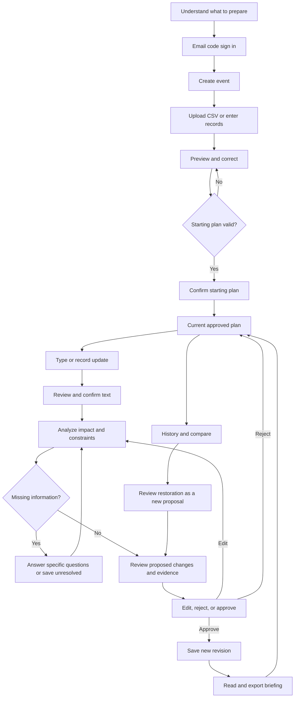

# Experience and visual system

## Summary

Give the organizer a calm event workspace with a clear current plan and one obvious next action. Make a proposed revision feel like reviewing a short operational change sheet. The interface must remain usable on a phone under time pressure.

## Decision

Use the installed frontend design skill's Swiss anchor. White `#FFFFFF` and neutral `#F7F7F8` surfaces, Helvetica Neue, and Yves Klein Blue `#002FA7` provide a precise, readable foundation for schedules. The distinguishing move is a persistent revision comparison rail: every change aligns its before value, proposed value, and evidence in one visible row. On mobile these become stacked cards with the same reading order.

This direction is deliberate restraint for a busy workflow. No gradients, grain, serif headings, fabricated charts, mascot, generated imagery, or decorative status strips. Blue marks the primary next action. Status color always accompanies a word and symbol from a real icon set. No Unicode characters used as substitute icons.

**Implementation skills**: `frontend-design` at `/Users/asmasalleh/.codex/skills/frontend-design/SKILL.md`. No existing design file or reference screen was supplied. This document is the planning source; implementation can create `design.md` from it after approval without creating a second design authority.

## Journey



Missing information here refers to questions EventOps asks its organizer during use. It does not imply questions are needed from you during this planning assignment.

## Navigation

Public routes: short product introduction, sign in, privacy, terms, and a useful not found page. The introduction explains the workflow, accepted inputs, truthful capability limits, and “Create an event”. No testimonial or pricing section is needed.

Signed in: an event selector, account menu, and event navigation with **Plan**, **Updates**, **Briefing**, and **History**. Rooms, volunteers, and assignments are views within Plan. Event settings sit in the event menu; workspace and privacy settings sit in the account menu. Display the event date, timezone, current revision, and last saved state where relevant.

On desktop, use a 224 px left navigation rail with a maximum content width of 1280 px. On small screens use a compact event header, a labeled navigation menu, and a persistent “Add update” button above the bottom safe area. Do not obscure content or focused controls with sticky bars. Use list views before a wide room grid on phones. A timeline is optional presentation of the same data, never the only way to edit or understand it.

## Screen inventory and screen by screen flow

Each row defines an actual route or distinct full screen state. Secondary actions are visible only when relevant.

| ID and screen | Purpose and content | Primary action | Secondary actions | Relevant states and recovery |
|---|---|---|---|---|
| S01 Introduction | Explain the operations loop; show preparation checklist and formats | Create an event | Sign in, privacy, terms | Signed in users can return to events; no fake example event in a real workspace |
| S02 Sign in | Email field, code input after sending, delivery explanation; adult eligibility attestation and linked privacy/terms on account creation | Send code, then Sign in | Change email, resend after cooldown | Sending, invalid or expired code, throttled, mail unavailable; preserve email and explain retry |
| S03 Your events | Real event list, date, timezone, revision, unresolved work | Create event in empty state; Open event on an event row | Resume draft, account settings | Empty, loading, failed fetch, archived events; no empty metrics |
| S04 Event setup | Name, event date, explicit IANA timezone, operating start/end, location labels | Save and add plan | Save draft, cancel | Field errors, timezone confirmation, invalid day or hours, save failure; retain input |
| S05 Add your plan | Schedule, rooms, volunteers, availability and assignments preparation; CSV template downloads | Choose CSV files | Enter manually, resume staged import | Drag and drop plus standard file picker, unsupported format, over size, incomplete set |
| S06 Import preview | Mapped columns, record totals from parsed data, row errors, links between records, corrections | Review starting plan when blocking errors are fixed | Save progress, replace file, download errors | Parsing, unknown reference, duplicate, missing availability, partial files; valid rows remain staged until whole confirmation |
| S07 Starting plan review | Full proposed starting schedule, rooms, coverage, data provenance and validation summary | Confirm starting plan | Edit records, return to preview | Blocked by collisions or unknown mandatory data; confirmation explicitly creates revision 1 |
| S08 Plan | Current approved schedule; view tabs for sessions, rooms, volunteers, assignments; unresolved update banner | Add update | Propose manual edit, filter, open briefing, event settings | Honest empty before confirmation, live plan, loading, offline read failure, pending changes; never show draft as approved |
| S09 New update | Text input and optional record button; explain recording limit and provider processing before use | Review text after typing or recording | Save draft, discard draft | Microphone permission denied, recording, stop, playback, conversion/transcription, retry, text alternative |
| S10 Confirm update text | Original transcript, editable corrected text, recording playback while retained, event date/timezone | Analyze update | Save draft, record again, delete audio | Empty speech, suspected name ambiguity, transcription unavailable; no analysis without explicit confirmation |
| S11 Analysis progress | Persisted stage names: Reading update, Checking plan, Preparing options | Open proposal when ready | Cancel analysis, return to plan | Queued, in progress, delayed, rate limited, failed, retry; no invented percentage or success animation |
| S12 Proposal review | Request summary, affected records, before/after rows, rule results, alternatives, evidence and specific questions | Answer questions when blocked; Review approval when valid | Edit candidate, choose alternative, save unresolved, reject | Unresolved, infeasible, valid, stale, AI failure, manual mode; approval unavailable while blocked with readable reason |
| S13 Approval confirmation | Exact revision and candidate being saved, changes, included resolutions, remaining informational warnings | Approve revision | Back to proposal | Saving, already approved, stale version, validation changed, failure; double click cannot duplicate |
| S14 Saved revision and briefing | New revision label, change summary, full schedule, assignments and known issues from that revision | Download briefing | Print, export CSV, return to plan | Approved plan saved even if rendering fails; retry briefing for this revision |
| S15 Updates | Real update list with draft, unresolved, rejected or approved state | Add update | Resume, inspect evidence, filter status | No updates, loading, job failure, stale proposal; rejection remains inspectable |
| S16 History and comparison | Revisions, actor, timestamp, reason, source update; compare two versions | View revision | Compare, Review restore | Historical label prominent; restoring creates candidate against current head, not an instant overwrite |
| S17 Event settings | Setup facts, archive, export, trash, recovery window | Save draft change or archive according to section | Export data, move to trash, restore from trash | Date/timezone changes after confirmation use a new proposal; trash requires explicit confirmation |
| S18 Workspace and privacy | Workspace name, sign out, retention controls, event export, account deletion | Save settings | Delete audio, export account data, request account deletion | Reauthentication for account deletion; clear deletion schedule and recovery state |
| S19 Service or access error | Explain unavailable service, expired login, inaccessible event or unknown URL | Retry or sign in as applicable | Return to events, use text/manual flow where available | Preserve acknowledged drafts; no disclosure that another workspace's event exists |

S14 is also the Briefing navigation destination for the latest approved revision. S12 includes an evidence side panel, editor drawer, question form, and rejection reason dialog. They are components of one review task, not a chat transcript that replaces the plan.

## Forms and imports

Use persistent visible labels, examples of accepted syntax, and “Required” text only where needed. Keep event details short; defer rooms and volunteer availability until plan entry. Browser timezone is a suggested default displayed for confirmation, never silently inferred as the event location. Prefer an explicit time field with `HH:mm`, date picker plus typed date, and a named timezone selection with offset preview.

Import copy: “Upload UTF 8 CSV files. Download the templates to see the required columns.” Explain that spreadsheets can be saved as CSV and that PDF, DOCX, ICS, XLSX, archives, and scans are not accepted in this release. Files go to staging. Show column mapping only where headers differ; never make fuzzy record matches silently. Error example: “schedule.csv, row 8, room_id: R2 is not in your room list. Choose a room or add it.”

Import confirmation must be distinct from uploading. Save partial work, show the count of blocking errors, link each error to an editable cell, and offer a downloadable error report. Undo a correction before confirming. After confirmation all edits go through a reviewed revision.

## Conflict, evidence, and approval language

| Category | Presentation |
|---|---|
| Original source | File name escaped as text, row/column or manual entry ID, captured date, immutable value |
| New update | “Organizer update, awaiting approval” with confirmed text and timestamp |
| Proposed change | “Proposed” above before/after values, reason, citations, request coverage |
| Approved plan | “Approved revision N” with saved time and named actor |
| Conflict | Named rule and records involved, the consequence, then available actions |
| Missing fact | A single answerable question with affected item, required field, and why it matters |
| Unresolved request | Show the original request and why it has not been satisfied |
| Evidence | Source link opens the actual frozen record and relevant field, not a generated citation title |

Approval copy: “Save these changes as revision N. This updates your event plan and briefing. No messages will be sent.” Calculate N at review time, and verify it again during approval. If another revision has been approved: “Your plan changed since this proposal was prepared. Review it against revision N.” Do not suggest approval succeeded before commit acknowledgement.

## Textual wireframes

These are planning artifacts. All names and times below are from the internal scenario, not live account data.

```text
EVENT / DATE / TIMEZONE                    Approved revision 3
Plan  Updates  Briefing  History                         Add update

Current plan
Time           Session           Room        Volunteer coverage
10:00 to 11:00  Workshop A        Room 1      1 required, 1 assigned
10:00 to 11:00  Workshop B        Room 2      1 required, 1 assigned

Unresolved update
Volunteer cancellation and requested room move
Continue review
```

```text
Review update                              Based on revision 3
Your request: move Workshop A to Room 2 and remove its volunteer.

Needs your answer
Room 2 is occupied from 10:00 to 11:00.
What must the new room provide? [Required feature or reason]
May Workshop A move to a later time? [Choose yes or no]

Proposed changes       Before        Proposed          Evidence
Volunteer availability Available     Unavailable       Update text
Workshop A room        Room 1        Unresolved        Room 2 booking
Workshop A coverage    Assigned      Unresolved        Roster + update

Save unresolved        Edit manually        Approval unavailable
```

```text
Ready for review                          Based on revision 3
Chosen alternative: shift Workshop A to the confirmed free slot.
Show all changed fields                    Open evidence

Session / time / room / coverage comparison rows
Checks: no collisions, availability and coverage confirmed
Requests: cancellation handled, Room 2 move satisfied

Reject                      Edit candidate       Review approval
```

## Design tokens and components

| Token group | Proposed values |
|---|---|
| Surfaces | `#FFFFFF` base; `#F7F7F8` secondary; `#FFFFFF` raised review surface |
| Text | `#18181B` primary; `#52525B` secondary; `#FFFFFF` on primary action |
| Accent | `#002FA7`; selected state has underline and label as well as color |
| Rules and focus | `#D4D4D8` structural rules; `#71717A` control boundary; 2 px blue focus outline with 2 px offset |
| Semantic text | `#9F1239` blocking; `#854D0E` caution; `#166534` valid; each with explicit text |
| Typeface | `Helvetica Neue`, Helvetica, Arial, sans serif, one family for all display and body |
| Type sizes | 16 px body; 14 px secondary; 20 px section; 28 px page; 36 px restrained introduction title; line height 1.5 for body |
| Numbers | Tabular numerals for times, dates, revision numbers and comparison rows |
| Spacing | 4, 8, 12, 16, 24, 32, 48 px; form groups 24 px; comfortable row height at least 48 px |
| Shape | 1 px rules, 6 px control corners, 8 px dialogs; no decorative shadows |
| Layout | 24 px desktop gutters, 16 px mobile; 40 to 72 character text measure; breakpoints driven by content around 640 and 1024 px |
| Motion | 120 to 180 ms opacity and simple transitions; respect reduced motion; no parallax or essential animated content |

Contrast must be measured in the rendered combinations. Tokens are not a claim that the finished app conforms. Structural dividers can be subtle, but interactive boundaries and focus indicators must remain distinguishable. Color never encodes the only difference between a source, conflict, proposal, and approval.

Reusable components: event header, plan list, accessible data table, record editor, error summary, file picker, source viewer, question card, comparison row, validation summary, status message, job progress, confirmation dialog, revision selector, print briefing. Use a real icon set only where it clarifies a labeled action.

## States and accessibility

Every asynchronous screen preserves its title and shows a useful status message. Save states distinguish “Saving”, “Saved”, and “Could not save”. A lost connection retains unsent text in memory; show a warning before navigation if it has not been acknowledged by the server. Do not promise that a closed tab saved unacknowledged edits. No personal event content is persisted to browser local storage in the first release.

Target WCAG 2.2 AA. Provide a skip link, proper landmarks and heading order, associated error descriptions, keyboard access to every action, focus restoration after dialogs, and an announced status region that does not interrupt every poll. Use at least 44 px practical touch targets. Tables have captions and headers; mobile comparison cards have complete labels. No drag action or recording gesture is mandatory. Support 200 percent zoom, 320 CSS px reflow, reduced motion, and password manager or paste use for sign in codes. [WCAG 2.2](https://www.w3.org/TR/WCAG22/).

## Consequences

An evidence first review needs careful density control, especially on mobile. Show the unresolved questions before a long comparison, collapse unchanged rows by default, and keep the full plan one action away. Avoid adding dashboard or chat surfaces that compete with the operational task.
