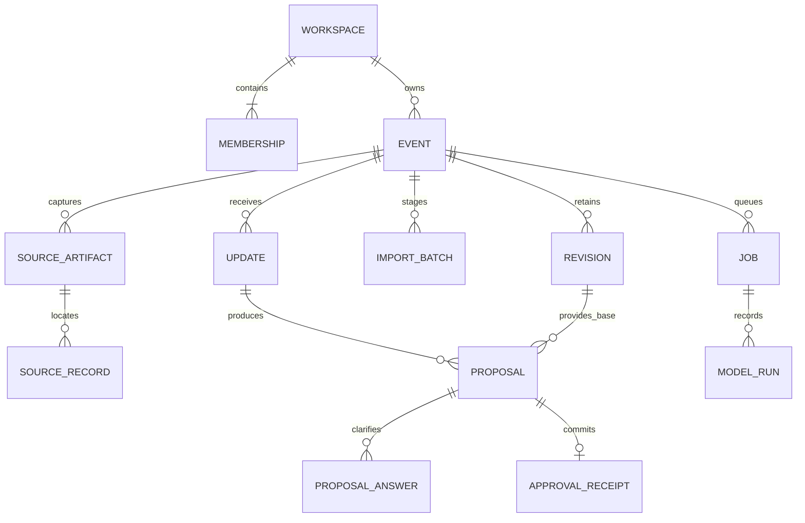
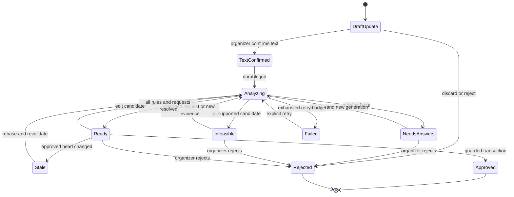

# Data, imports, and approval contract

## Summary

Keep each approved plan as an immutable snapshot. Sources, organizer updates, proposals, and approvals are separate records. A guarded database transaction is the only way to advance the official plan.

## Decision and alternatives

Recommend relational workflow records with bounded JSON plan snapshots. This makes a past revision directly reproducible and keeps event scale small enough for complete checks. Fully normalized tables for every record in every revision offer stronger relational querying but add copy and history complexity. An append only operation log alone is compact but makes restoration and evidence resolution depend on replay code. Reconsider normalized snapshot tables if real events exceed the release limits. (Basis: immutable revision history and explicit product limits.)

## Limits and time semantics

These are product limits, not provider limits: one local event date; operating start and end within that date; 100 sessions; 20 rooms; 100 volunteers; 500 assignments; 1,000 availability intervals; 100 explicit dependency edges; 500 approved revisions per event; 10 active events per workspace. Reject a limit before uploading or analyzing where possible. No overnight or recurring events. Archive and create another event for a later date. No public scale claim exceeds these bounds.

Use IANA timezone identifiers. Store the event date, timezone, local operating hours, and resolved UTC instants in each snapshot. Resolve `YYYY-MM-DD` plus `HH:mm` with a timezone library backed by the timezone database, not an offset string. A nonexistent local time is rejected. A repeated local time requires the organizer to select the intended offset. Store that explicit offset with the resolution. Never choose a daylight saving fold silently.

Intervals are half open `[start, end)`, so a session ending at 11:00 can share a room with one beginning at 11:00 if no setup buffer is required. Each session has explicit `setup_minutes` and `teardown_minutes`, default zero and shown during confirmation. Occupancy expands by these values; volunteers cover the session interval unless an assignment supplies explicit earlier/later times. All displayed and exported times include the event timezone and date. Relative dates resolve against the event date and explicit capture timestamp; ambiguous or contradictory phrases require confirmation.

## Entities and relationships

All persistent IDs are server generated UUIDs, and all timestamps are UTC `timestamptz`. All tables below have `created_at`. Event owned tables include both `workspace_id` and `event_id`; composite foreign keys enforce that those values agree with their parents. Workspace tables reference the workspace directly. UUID unpredictability is never authorization.

| Entity | Required fields | Nullable or optional fields and constraints |
|---|---|---|
| Profile | `user_id` linked to managed identity, `adult_attested_at`, `terms_version`, `privacy_version` | `display_name`; no birth date collected |
| Workspace | `id`, `name`, `owner_user_id`, `retention_policy_version` | `deletion_requested_at`, `purge_after`; one active workspace per owner in release |
| Membership | `workspace_id`, `user_id`, `role=owner` | Unique pair; only one owner per workspace; no invitation endpoint |
| Event | `id`, `workspace_id`, `name`, `status`, `draft_generation` | `current_revision_id`, `archived_at`, `trashed_at`, `purge_after`; current revision must belong to this event |
| PlanDraft | `id`, event keys, `generation`, typed `snapshot`, `schema_version` | `base_revision_id` absent before initial confirmation; draft generation increments on save |
| SourceArtifact | `id`, event keys, `kind`, `sha256`, `captured_by`, `captured_at`, `metadata` | `object_key`, escaped display filename, `expires_at`, `content_deleted_at`; source metadata survives scheduled file deletion |
| SourceRecord | `id`, event keys, `artifact_id`, `locator`, `value_json`, `sha256` | Immutable captured field values; locator is CSV row/column, manual entry field, or transcript character range |
| ImportBatch | `id`, event keys, `state`, `draft_generation`, staged snapshot, validation issues | Original file IDs; confirmation links revision 1; parsing never writes current head |
| Update | `id`, event keys, `input_kind`, `raw_text`, `state`, `generation`, `captured_at` | `audio_artifact_id`, `confirmed_text`, `confirmed_at`, `confirmed_by`; text versions and later answers stored as source records |
| Proposal | `id`, event keys, `update_id`, `base_revision_id`, `generation`, `state` | Candidate snapshot, canonical patch, patch digest, constraint report, request coverage, `validator_version`, `model_run_id`; no candidate is implicitly approved |
| ProposalAnswer | `id`, event keys, `proposal_id`, `question_id`, `answer_json`, `source_record_id`, actor | Append only; superseding answer references prior answer; cannot mutate original transcript |
| Revision | `id`, event keys, `revision_number`, `snapshot`, `schema_version`, `sha256`, `approved_by`, `approved_at`, `reason`, `parent_revision_id` | `proposal_id`, `restores_revision_id`; parent absent only for revision 1; unique event and revision number |
| ApprovalReceipt | `id`, event keys, actor, `idempotency_key`, `request_digest`, `revision_id`, candidate digest | Unique event, actor, operation, key; immutable successful response |
| AuditEvent | `id`, workspace keys, action, actor type/ID, timestamp, target IDs, safe metadata | Optional event key; append only until retention/deletion; no credentials or raw content |
| Job | `id`, event keys, `kind`, `state`, `attempts`, `generation`, `not_before` | `lease_until`, `worker_id`, heartbeat, safe error code; unique deduplication key |
| ModelRun | `id`, event keys, job ID, model ID, prompt/schema version, status, usage and cost reservation | Provider request ID, observed usage, redacted error code; raw output belongs in private proposal storage, not telemetry |

Authentication provider identity has a one to one Profile relationship and can own a workspace through membership. The event's `current_revision_id` points to one of its revisions. The ER diagram simplifies foreign keys; the table specifies the composite ownership constraints.

## Plan snapshot schema

Each snapshot has `schema_version`, `event` metadata and these arrays. IDs remain stable between revisions. External CSV identifiers are mapped to UUIDs once and retained as `external_id` for display and later duplicate detection. Names are never identifiers.

| Record | Required fields | Optional fields and rules |
|---|---|---|
| Room | `id`, `external_id`, `name`, `location`, `feature_tags` | `capacity` positive integer or null; unknown capacity cannot establish a match for a capacity requirement |
| Session | `id`, `external_id`, `title`, local and UTC start/end, `room_id`, `required_volunteers`, required feature tags, setup and teardown minutes | `expected_attendance` integer or null, `required_role_tag` string or null; required volunteers is an explicit integer including zero |
| Volunteer | `id`, `external_id`, `display_name`, `role_tags`, `active` | No phone, email, home address, or free form personal notes in the first release |
| Availability | `id`, `volunteer_id`, start/end, `status=available or unavailable`, provenance | No intervals means unknown, never assumed available; overlapping unavailable intervals override available ones |
| Assignment | `id`, `volunteer_id`, `session_id`, `role_tag`, start/end | Times default to session interval and are materialized; one assignment per volunteer/session/role |
| Dependency | `id`, `predecessor_session_id`, `successor_session_id`, `minimum_gap_minutes` | No self edges or cycles; order and gap must hold |
| Provenance | record ID, field path, source record IDs, derivation kind | Required for changed fields and imported facts; defaults identified explicitly |

Capacity and expected attendance can both be unknown when no capacity based decision is made. A supplied attendance requirement with unknown destination capacity blocks a proposed move until capacity is confirmed. Blank role requirements impose no extra skill constraint, but are visibly labeled “No specific role required”. Location labels do not establish travel time. Events spanning sites with required travel need explicit buffers; automatic travel routing is deferred.

## Import contract

Release imports accept UTF 8 CSV, with or without BOM, comma delimiter, first row headers, RFC style quoted fields, CRLF or LF. Limit each file to 2 MiB and a batch to 10 MiB; reject embedded NUL bytes, invalid encoding, duplicate headers, and malformed rows. Bounds also apply after parsing. No formulas are executed. Headers can be mapped explicitly, while unmapped required columns block confirmation. Ignore no rows silently.

| Template | Required columns | Optional columns |
|---|---|---|
| `rooms.csv` | `room_id,name,location` | `capacity,feature_tags` |
| `schedule.csv` | `session_id,title,start,end,room_id,required_volunteers` | `expected_attendance,required_role_tag,required_feature_tags,setup_minutes,teardown_minutes` |
| `volunteers.csv` | `volunteer_id,name` | `role_tags,active` |
| `availability.csv` | `volunteer_id,start,end,status` | None |
| `assignments.csv` | `session_id,volunteer_id,role_tag` | `start,end` |
| `dependencies.csv` | `predecessor_session_id,successor_session_id,minimum_gap_minutes` | None |

Use `HH:mm` for import times on the event date. Tags are semicolon separated trimmed values. `active` defaults true with a visible default notice. Integer defaults for buffers are zero, never for missing `required_volunteers`. `role_tag` may contain the literal `general` if no specialist role is required. Availability status is exactly `available` or `unavailable`. IDs are case sensitive strings of 1 to 64 safe printable characters; keep the original spelling. Names and titles are at most 160 characters, location 240, tags 64 each and at most 20 per record.

Rooms and schedule are needed for a confirmed event. A roster can be empty only if all sessions explicitly require zero volunteers. A nonempty roster without availability can be staged, but mandatory assignments need known availability before confirmation. Assignment imports are optional: fill coverage in the manual editor. Dependencies are optional and can be entered manually. Manual forms write the same schema and capture immutable source records.

Validate in order: bytes and type, headers, field shapes, references, duplicate IDs, event time range, constraints, mandatory coverage, source mappings. Show row, column, offending value, readable reason, and a suggested correction action. All files remain staged until the organizer reviews the entire candidate starting plan.

Within a batch, identical duplicate IDs and values can be grouped for explicit “Keep one” confirmation. Same ID with different values is a blocking conflict. Similar names with distinct IDs receive a warning, never automatic merging. A repeated exact file hash in the same event offers the prior import, never reimports automatically. Release supports initial import only; later bulk replacement is deferred. Subsequent corrections use proposals. CSV exports prefix cells beginning with formula triggers (`=`, `+`, `-`, `@`, tab, CR) with an apostrophe and quote them safely.

## Deterministic constraint rules

1. Every referenced ID exists and belongs to the snapshot; times and counts meet the schema and event limits.
2. Expanded room occupancy intervals cannot overlap for distinct sessions in the same room.
3. A volunteer's assignment intervals cannot overlap. Each assignment must fit a confirmed available interval with no intersecting unavailable interval, and the volunteer must be active.
4. Mandatory coverage meets each session's count; assigned people are distinct and satisfy an explicit role tag if one is required.
5. Explicit capacity, equipment tags, hours, buffers and dependencies must be satisfied. No unknown value is treated as evidence of suitability.
6. Dependency graphs have no cycles, and times respect predecessor finish plus minimum gap.
7. Every original request is marked `satisfied`, `needs_answer`, `infeasible`, or `withdrawn_by_organizer`. Withdrawal needs explicit recorded confirmation. Unhandled or contradicted requests block approval.
8. No automatic changes to unrelated sessions. Alternatives that move another session are shown for explicit organizer selection and revalidation, with all affected requests and assignments visible.

Both the TypeScript validator and a database validator enforce the rules relevant to a commit. Maintain a shared named rule catalog and parity fixtures. SQL does not trust a client supplied “valid” flag. A deterministic check is evidence of compliance with known constraints, not a claim of physical safety or actual attendance.

## Lifecycle and history

Events move from draft to active on initial confirmation; active events can be archived and reopened. Trashed events have access disabled except recovery controls, can be restored for seven days, and are then purged. Archiving preserves records. Account deletion uses its separately disclosed grace period in operations.

Proposal payloads are immutable per generation. Edit or new answers create the next generation and invalidate the old validation report. Rejection retains the update and candidate for history. A completed job for an earlier generation cannot replace the current candidate.

Restoration copies a historical snapshot into a new proposal against the current revision, shows the entire difference, and checks current explicit facts. In particular, an approved cancellation or later unavailability must not be silently reversed by restoring an older plan. The organizer must explicitly reconfirm changed availability with a new source record, or the restoration remains blocked. Approval adds a revision referencing both its current parent and the historical revision; it never resets the head pointer backwards.

## Approval transaction and idempotency

Use a restricted PostgreSQL function called by the web application with the verified user's JWT. It is a `SECURITY DEFINER` function only where narrow table privileges require it; set a fixed `search_path`, revoke public execution, grant only the intended authenticated role, verify `auth.uid()` and owner membership, and never accept actor identity from JSON. Direct authenticated INSERT/UPDATE/DELETE privileges on revisions, receipts, audit records, and head pointers are denied. Proposal readiness, generation, stored digests, validation reports and confirmed source records also cannot be assigned through generic table updates. Restricted draft/confirm/validate functions own those transitions. All reads and permitted draft operations use row security. This prevents bypassing the function through the database API.

Approval input: event ID, proposal ID, base revision ID, proposal generation, candidate digest, and a fresh client generated idempotency UUID. The function does the following within one transaction:

1. Lock the event row, verify it is active and owned by the caller, and verify the workspace is not pending deletion.
2. Look up the scoped idempotency receipt. A matching request digest returns the saved revision even if the head has since advanced. A reused key with different content returns `409`.
3. Lock the selected proposal. Require `Ready`, matching generation and digest, same event, and expected base equal to the current approved head. Otherwise return `409 STALE_PLAN` or `409 PROPOSAL_CHANGED` without writes.
4. Recompute the candidate from the trusted stored base and allowlisted patch, compare digest, resolve evidence references, validate rules and request coverage against immutable confirmed evidence, and reject with `422` on failure.
5. Insert revision N+1 and audit event, update the current pointer and proposal state, and insert the receipt. Unique constraints prevent duplicate revision numbers or approvals of the same generation.
6. Commit before returning the receipt. Briefing rendering is outside the transaction and can be retried independently.

Initial plan confirmation follows the same boundary using an import batch and expected draft generation, with a null current head. Exactly one request can create revision 1. No AI call, network request, mail send, or file write occurs inside either transaction. Server crashes before commit change nothing; crashes after commit are resolved by replaying the idempotency key. Retry stored keys for at least the event's retained lifetime.

## API surface

Protected endpoints require a verified session and owner membership. IDs in the path are checked against the same workspace and event as every referenced object. Responses use a stable error envelope `{code, message, field_errors, request_id, retry_after_seconds}` with no stack traces.

| Endpoint | Method and key input | Output | Important failures |
|---|---|---|---|
| `/api/workspace/bootstrap` | POST, idempotency key | Existing or new owned workspace | 401, 409, 429 |
| `/api/events` | GET or POST, setup draft fields | Owned list or draft event | 401, 422, 429 |
| `/api/events/:id/plan` | GET, optional revision ID | Snapshot with approved/historical label | 404 for absent or inaccessible |
| `/api/events/:id/draft` | PUT, expected generation, snapshot fields | Saved generation | 409, 422 |
| `/api/events/:id/imports` | POST, validated CSV multipart, dedup key | Batch/job ID, `202` if parsing queued | 413, 415, 422, 429 |
| `/api/events/:id/imports/:batch` | GET or PUT, correction and generation | Staging rows, issues, saved generation | 404, 409, 422 |
| `/api/events/:id/confirm-plan` | POST, batch/draft generation, digest, key | Revision 1 receipt | 409, 422 |
| `/api/events/:id/updates` | POST, text or validated recording, key | Draft update ID | 413, 415, 422, 429 |
| `/api/events/:id/updates/:update` | PUT, expected generation, corrected text | Saved text and generation | 409, 422 |
| `/api/events/:id/updates/:update/analyze` | POST, confirmed text digest, base revision, key | Proposal and job IDs | 409, 422, 429, 503 |
| `/api/events/:id/proposals` | POST, `mode=manual`, expected head, typed patch, confirmed manual source, key | Manual proposal and deterministic validation report | 409, 422 |
| `/api/events/:id/proposals/:proposal` | GET or PUT, generation and manual edits | Candidate, questions, validation report | 404, 409, 422 |
| `/api/events/:id/proposals/:proposal/answers` | POST, generation, typed answers | New generation and job ID | 409, 422 |
| `/api/events/:id/proposals/:proposal/approve` | POST, transaction inputs above | Durable approval receipt | 401, 404, 409, 422 |
| `/api/events/:id/proposals/:proposal/reject` | POST, generation, optional reason | Rejected state | 409 |
| `/api/events/:id/revisions` | GET, cursor | Paginated history | 404 |
| `/api/events/:id/restore` | POST, target revision, expected head, key | New manual proposal | 409, 422 |
| `/api/events/:id/briefing` | GET, revision and output format | HTML print view, text or CSV download | 404, 503 rendering unavailable |
| `/api/events/:id/evidence/:source` | GET, validated locator | Frozen source value, context, retention state | 404, 410 raw content expired |
| `/api/jobs/:job` | GET or POST cancel | Owned progress or cancelled state | 404, 409 |
| `/api/events/:id/lifecycle` | POST, archive/reopen/trash/restore | Result and recovery deadline | 409, 422 |
| `/api/workspace/export` | POST, fresh session | Private export job ID | 401, 429 |
| `/api/account/deletion` | POST or DELETE cancellation, recent reauthentication | Deletion request or cancellation receipt | 401, 409 |

User visible settings updates also require expected generation and server authorization. Never expose a generic arbitrary database write endpoint. Unknown fields, unsupported patch operations, and excessive request sizes are rejected.

A manual proposal creates an Update with `input_kind=manual_edit` and a confirmed source record describing the organizer's explicit edits. Its `update_id` is required like an AI proposal's. It runs deterministic validation directly, with no model dependency, and follows identical revision and approval rules. Each proposed field value is itself an organizer assertion, clearly labeled as manual evidence; importing or restoring old values cannot masquerade as a new availability confirmation.

## Value sourcing

| Display or action value | Canonical source |
|---|---|
| Actor and permissions | Server verified identity plus Membership, never form fields or model text |
| Selected workspace | Session's owned workspace resolved by membership; path IDs checked within it |
| Event date/timezone and operating hours | Organizer confirmed setup in current revision or saved setup draft |
| Current plan and revision label | `Event.current_revision_id` joined to same event Revision |
| Import value and error location | Parsed CSV field linked to artifact hash and original row/column; corrections append source records |
| Confirmed update text | Update generation explicitly confirmed by organizer; no unreviewed transcript |
| Cancellation and replacement availability | Referenced update or answer plus roster and availability records; never name similarity |
| Room fit | Room capacity/features and session requirements in cited snapshot or confirmed new evidence |
| Candidate before values | Stored immutable base revision; server computes diff |
| Candidate after values | Validated patch applied to that base; manual edits are confirmed evidence |
| Conflict labels | Named deterministic rule plus record IDs and interval comparisons |
| Explanation and alternatives | Model output checked against rule report and evidence; unsupported facts rejected |
| Request satisfaction | Original confirmed update claims matched to explicit candidate changes or organizer withdrawals |
| Approval count and number | Actual server diff and locked event head, then durable receipt |
| Briefing and change summary | Selected approved snapshot, predecessor diff, persisted informational issues, escaped text |
| Historical restore warnings | Difference from current head plus later confirmed availability and outstanding update evidence |
| Deletion date | Server UTC request time plus disclosed grace period, shown in local timezone |

## Consequences

Snapshots simplify review at this scale but are inefficient for large analytical queries. Immutable means immutable during normal retention; a privacy deletion purges event contents, source records, proposals, and revisions according to the deletion policy. State that exception clearly. A single owner still needs concurrency protection because two tabs and delayed requests can race.
